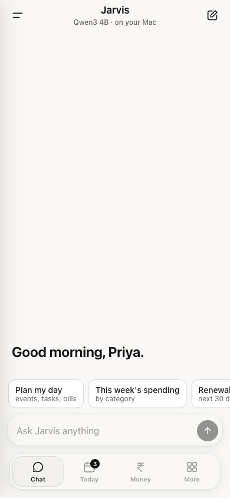
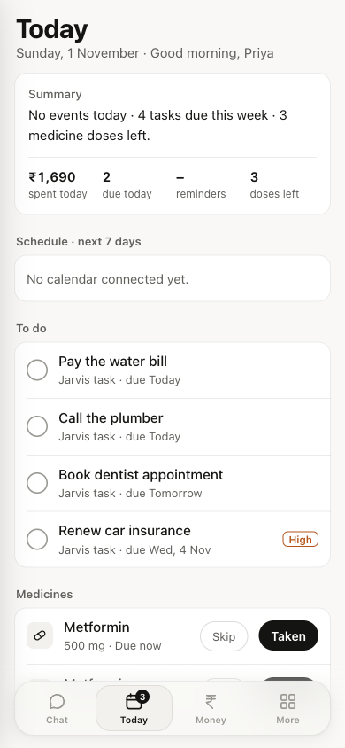
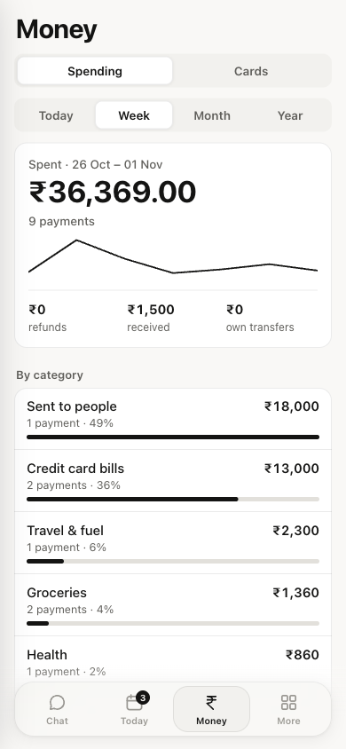
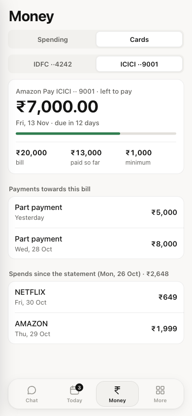

# Jarvis

**A private personal assistant that runs on your own computer or a free cloud server.**
It reads your documents, calendar, email and bank alerts, keeps your tasks, medicines and bills, and answers
in your language, from a phone app, from Telegram, or both. Nothing is sent to an AI company, and it costs nothing
to run.

[](https://github.com/GuruGd29/jarvis-assistant/actions/workflows/weekly-tests.yml)
[](LICENSE)

<p align="center">
  
  
  
  
</p>
<p align="center"><sub>The phone app: Chat, Today, Money and Cards, shown with made-up data.
Also: <a href="docs/screenshots/more.png">More screen</a> · <a href="docs/screenshots/today-dark.png">dark mode</a></sub></p>

---

**Contents:** [What it does](#what-it-does) · [How it works](#how-it-works) · [Why Jarvis](#why-jarvis) ·
[What it costs](#what-it-costs) · [What you need](#what-you-need) · [Install](#install) ·
[After installing](#after-installing) · [Settings for your country](#settings-for-your-country) ·
[Security and privacy](#security-and-privacy) · [Updates](#updates) · [Testing](#testing) · [Speed](#speed) ·
[Honest limits](#honest-limits) · [FAQ](#faq) · [Who made this](#who-made-this)

## What it does

| | |
|---|---|
| 💬 **Chat** | Ask anything, in English or your own language (Tamil and Tanglish are tested weekly). It replies in the language you write in, and can read replies aloud. |
| 📄 **Your files** | Put documents in `~/Jarvis` (PDF, Word, text, Markdown, CSV). Jarvis indexes them and answers from them, naming the file: *"Your car insurance renews on 15 December 2026. Source: car-insurance.md"*. It can also copy one Google Drive folder when you say "sync drive". |
| 📅 **Calendar and tasks** | Reads Google and iCloud calendars, keeps its own tasks with reminders, and can read your iPhone Reminders. It adds a calendar event only after you say yes. |
| 📧 **Email** | Reads Gmail (read-only) to summarise your inbox. It can never send, reply or delete. |
| 💰 **Money** | Turns your bank's alert emails into exact spending totals by day, week, month and category, plus a **Cards** view: each credit card's bill, part payments, amount left and due date. Totals are worked out by the database, never guessed by the AI. |
| 💊 **Health** | Medicine reminders ("taken" / "skip"), and lab results from your reports with LOW/HIGH flags. It summarises; it does not diagnose. |
| 🔔 **Renewals** | Finds "renews on", "valid until" and expiry dates in your files and reminds you before them. |
| 🧠 **Memory** | Remembers what you tell it ("remember that my sister is Meena"). "What do you know about me" and "forget …" work any time. |
| ☀️ **Briefings** | A morning brief (events, tasks, unread mail, medicines, yesterday's spending), a Sunday summary of the week and a monthly money report, as phone notifications and/or Telegram messages. |

## How it works

```
 Phone app (web app) ──HTTPS──▶ Caddy ──▶ app server (jarvis/web) ──▶ Hermes Agent ──▶ Ollama (Qwen3 4B)
 Telegram ─────────────────────────────────────────────────────────▶ Hermes Agent        │
                                                                     │  Jarvis plugin     │
                                                                     ▼  + tools (MCP)     ▼
                                                   jarvis package: search, money, tasks, health, memory
                                                                     │
                                                   Postgres + pgvector · Google / iCloud · ~/Jarvis files
```

- **[Hermes Agent](https://github.com/NousResearch/hermes-agent)** (open source, MIT) runs every conversation and
  the scheduled jobs. Jarvis adds a **plugin** that puts exact facts into each turn (money totals, calendar,
  medicines, file passages, remembered facts), and **tools** the model can call (search, add a task, propose an
  event).
- **[Ollama](https://ollama.com)** runs the AI models on your own machine: **Qwen3 4B Instruct** (Apache 2.0) for
  chat, **bge-m3** (MIT) for search and the **bge-reranker-v2-m3** reranker, all multilingual.
- **Postgres with pgvector** stores the search index, tasks, money, health records and memory.
- **The app server** (`jarvis/web`) serves the phone app, streams chat replies and sends push notifications.
- **Scheduled jobs** send reminders and briefings, read new bank emails, index new files every 15 minutes, and learn
  from the day's chats at night.

<details>
<summary>Repository layout</summary>

```
install.sh              One-command install on Linux (Ubuntu 24.04+, ARM64 or x86-64)
.env.example            Every setting, explained
jarvis/                 The assistant (Python package)
  config.py               settings from .env: country, currency, languages, models, folders
  search.py ingest.py     file search (vector + keyword + reranker) and indexing of ~/Jarvis
  money.py money_ai.py    bank alert emails → transactions; the AI reader for other banks
  calendars.py mail.py    Google / iCloud calendars, iPhone Reminders, Gmail (read-only)
  tasks.py health.py      tasks and reminders, medicines and lab results
  renewals.py learn.py    renewal dates from files; long-term memory
  briefing.py             morning brief, weekly and monthly reports
  safety.py               removes instructions hidden in files and emails
  mcp_server.py           tools the model can call
  web/                    the app server and notifications
web/app/                The phone app (HTML, CSS, JavaScript, service worker)
hermes/                 Jarvis's parts for Hermes: plugin, SOUL.md (persona), scheduled-job scripts
deploy/                 Hermes config, Ollama Modelfile, systemd services, Caddy and launchd examples
sql/                    Database schema (jarvis-migrate applies it)
bin/                    apply-settings.sh, backup.sh, startup.sh (Mac)
tests/                  Unit tests, and tests/ci: the weekly end-to-end test run
docs/                   Guides: Mac install, Oracle Cloud, phone access, Google, money, backups
```

</details>

## Why Jarvis

|  | Jarvis | Cloud assistants | A local chat app on its own |
|---|---|---|---|
| Where your documents, mail and bank data go | Stay on your machine | To the provider's servers | Stay on your machine |
| Monthly cost | Free (free server or your own computer) | Free tier, paid plans for more | Free |
| Calendar, mail, money, medicines, bills | Built in | Through add-ons, varies | Not included |
| Money totals | Computed exactly by the database, with a card bill tracker | Not built in | Not included |
| Changes things without asking | Never: mail and Drive are read-only, calendar needs your yes | Varies | No |
| You can read and change everything | Yes, MIT licence | No | Yes |

Cloud assistants are faster and cleverer than a 4-billion-parameter model on a CPU. Jarvis trades some of that for
privacy, zero cost, exact answers about your own life, and [public weekly tests](#testing). See
[Honest limits](#honest-limits).

## What it costs

**Nothing.** Every part is free and open source, and it runs on hardware you already have or on Oracle Cloud's
*Always Free* server.

| Item | Cost |
|---|---|
| Software: Jarvis, Hermes Agent, Ollama, Qwen3, Postgres, Caddy, WireGuard, restic | Free, open source |
| Oracle Cloud Always Free Ampere A1 server (2 OCPU, 12 GB memory) | Free ([guide](docs/oracle-cloud.md)) |
| Google sign-in for Calendar, Gmail and Drive (your own Google Cloud project) | Free |
| Telegram bot (optional) | Free |
| Encrypted backups to Oracle Object Storage (20 GB free) | Free |
| Or your own Mac or Linux PC | Electricity only |

Oracle asks for a card when you sign up to verify who you are; Always Free resources aren't charged as long as you
stay within the free limits the guide uses.

## What you need

| | Minimum | Comfortable |
|---|---|---|
| **Linux server or PC** | Ubuntu 24.04+, ARM64 or x86-64, 8 GB memory, 25 GB free disk | 12 GB memory, 4 cores |
| **Mac** | Apple silicon, 16 GB memory | 32 GB |
| **Phone** | A recent iPhone or Android phone with its normal browser | |
| **Accounts** | None to start. Google for calendar, mail and money; Telegram if you want it | |

## Install

### Linux server or PC (recommended)

```bash
git clone https://github.com/GuruGd29/jarvis-assistant.git ~/jarvis-system
cd ~/jarvis-system && ./install.sh
```

The installer asks a few short questions: your name, your country's number and date style, currency, time zone,
languages, and an optional Telegram bot. Then it sets everything up in order:

1. Checks the machine (Linux, memory, disk, sudo).
2. Installs Postgres with pgvector, Python, restic and sqlite.
3. Creates the database and Jarvis's Python environment.
4. Installs Ollama and downloads the models (about 4 GB).
5. Installs Hermes Agent at the tested version, with Jarvis's settings, persona and plugin.
6. Starts three services that come back after a reboot: `ollama`, `jarvis-hermes` and `jarvis-web`.
7. Adds the scheduled jobs (reminders, briefings, money, indexing, learning).

It takes 15–30 minutes, mostly downloads. Running it again is safe: it keeps your settings and data and only adds
what's missing. This exact installer runs from scratch every week in the [weekly tests](#testing), on an ARM
machine set up like Oracle's free server.

**New to servers?** [docs/oracle-cloud.md](docs/oracle-cloud.md) walks through creating the free Oracle server.

### Mac

See [docs/install-mac.md](docs/install-mac.md): the same pieces, installed by hand (Docker for Postgres, the Ollama
app, a login item for the app server).

## After installing

In this order:

1. **Reach it from your phone**: [docs/remote-access.md](docs/remote-access.md) sets up a private WireGuard VPN and
   HTTPS. Then *Add to Home Screen*, and turn on notifications in **More → Notifications**.
2. **Add your files**: copy documents into `~/Jarvis/documents`, `finance`, `health` or `notes`. They're searchable
   within 15 minutes.
3. **Connect Google** for calendar, Gmail and Drive: [docs/google.md](docs/google.md) (about 15 minutes, once).
4. **Money from bank emails**: [docs/money.md](docs/money.md). List your bank's alert addresses and Jarvis builds
   your spending and card bills.
5. **Backups**: [docs/backups.md](docs/backups.md). Encrypted, daily, to free cloud storage.
6. **Telegram** (optional): run `./install.sh` again and give it a bot token.

Then try: *"Plan my day"*, *"How much did I spend this week?"*, *"When does my car insurance renew?"*,
*"Remind me to call the plumber tomorrow at 10"*, *"What did the bank email me about?"*

## Settings for your country

Everything that depends on where you live is a setting in `.env`; nothing is tied to one country.

| Setting | Example | What it changes |
|---|---|---|
| `JARVIS_OWNER_NAME` | `Priya` | Greetings: "Good morning, Priya" |
| `JARVIS_LOCALE` | `en_IN`, `en_US`, `de_DE` | How numbers, money and dates are written, and whether 05/12 is 5 December or May 12 |
| `JARVIS_CURRENCY` | `INR`, `USD`, `EUR` | The currency of totals; defaults to your country's |
| `JARVIS_TIMEZONE` | `Asia/Kolkata` | When reminders and briefings arrive, and what "today" means |
| `JARVIS_LANGUAGES` | `Tamil and English` | Which languages the assistant should expect |
| `JARVIS_MONEY_AI` | `nightly` | When the AI reads emails from banks without a built-in reader |

For example, `en_IN` with `INR` shows `₹1,50,000.50`, `en_US` with `USD` shows `$150,000.50`, and `de_DE` with
`EUR` shows `150.000,50 €`. Every setting is explained in [.env.example](.env.example). After changing one, run
`bin/apply-settings.sh` and restart Jarvis (`sudo systemctl restart jarvis-hermes jarvis-web`).

**Banks.** HDFC, ICICI and IDFC (India) have exact built-in readers. Alert emails from **any other bank** are read
by the local AI into a fixed form. An amount is saved only if that exact number appears in the email, in your
currency, and each email is read once, at night by default so it doesn't slow your chats. See
[docs/money.md](docs/money.md).

## Security and privacy

- **Your data stays on your machine.** The models run locally in Ollama, with Ollama's cloud features switched off,
  and Hermes's telemetry is off. Nothing is sent to an AI company.
- **Nothing listens on the internet.** Ollama, Postgres, Hermes and the app server listen on `127.0.0.1` only. On a
  server set up with [docs/remote-access.md](docs/remote-access.md), the only port open to the internet is
  WireGuard, and your phone joins that private network to use the app.
- **The app has no login of its own.** It relies on being reachable only from your own devices, through WireGuard
  or your home Wi-Fi. **Never expose it directly to the internet.**
- **Read-only where possible.** Gmail, Drive and iPhone Reminders are read-only. A calendar event is added only after
  you reply "yes" to Jarvis's proposal. Jarvis never sends email or pays anything.
- **Prompt injection.** Sentences in files or emails that try to instruct the assistant ("ignore previous
  instructions…") are removed before the model sees them. The weekly tests check this.
- **Secrets** (Google and iCloud sign-ins, bank settings) live in `secrets/` (mode 700) and `.env` (mode 600) and are
  never committed.
- **Backups** are encrypted with restic before they leave the machine. Without your password nobody can read them.
- **iPhone Reminders** are read only when you set `JARVIS_APPLE_REMINDERS=on`.

Found a security problem? See [SECURITY.md](SECURITY.md). Jarvis's use of Google data is described in
[PRIVACY.md](PRIVACY.md).

## Updates

```bash
cd ~/jarvis-system && git pull && ./install.sh
```

The installer updates the Python packages, applies new database changes (`jarvis-migrate`), refreshes Jarvis's
files in Hermes and restarts the services. Your `.env`, data and scheduled jobs are kept. Hermes Agent stays pinned
to the version the weekly tests use, and changes only when Jarvis moves it.

## Testing

Two layers run automatically every Sunday at 2:00 am India time on a free GitHub machine, with made-up data only:

- **30 unit tests** for rules that are easy to break quietly: money parsing, number and date styles, card bills,
  renewals, the prompt-injection filter, and the AI bank reader's safety checks.
- **46 end-to-end test cases**: Jarvis is installed with `install.sh` on an ARM64 machine set up like Oracle's free
  server (the model limited to 2 cores), and then the real thing is tested:

| Category | Cases | What it checks |
|---|---|---|
| Functional | 8 | bank email parsing, spending rules, card bills, periods, categories, Drive paths |
| Search | 3 | English, Tamil and Tanglish document search |
| API | 5 | every app screen's data, security headers |
| Server jobs | 2 | the morning brief and every scheduled job run cleanly with nothing connected |
| Chatbot | 14 | greetings, maths, document facts, exact money, tasks, memory, Tamil, Tanglish, a poem, a refusal |
| Hallucination | 4 | unknown facts, missing documents, false premises, unknown people |
| Security | 2 | prompt injection inside a document, leaking the system prompt |
| Consistency | 2 | the same question in three chats: same facts, at least 80% similar wording |
| Performance | 4 | median and slowest reply, time to first words, empty replies |
| Money AI | 2 | the AI bank reader on 8 made-up emails from banks without a built-in reader |

Each case records its number, name, precondition, steps, expected and actual result, and a match percentage. The
results appear as a table on the [run page](https://github.com/GuruGd29/jarvis-assistant/actions/workflows/weekly-tests.yml),
with a downloadable HTML and CSV report.

## Speed

Jarvis runs a small model on ordinary hardware, so expect a short pause rather than instant answers.

| Machine | Typical reply |
|---|---|
| MacBook Pro (M1 Pro, 32 GB) | 3–8 seconds once warm |
| GitHub test machine (4 x86 cores, no GPU) | about 40 seconds (median); first words after about 28 seconds |
| Oracle Always Free (2 ARM cores) | measured in every weekly run: see the latest report |

The first reply after a restart takes longer while the model loads. Scheduled briefings are put together without
the model, so they arrive on time even on a slow server.

## Honest limits

- **A 4B model makes mistakes.** It sometimes writes a tool call out as text instead of doing it (so adding a task
  can fail), and it can misread Tanglish questions. The weekly tests track these openly.
- **Slow on a CPU-only server.** See [Speed](#speed); a Mac with Apple silicon is much faster.
- **Bank alerts only.** Cash and payments without an alert email aren't counted. Built-in readers exist for HDFC,
  ICICI and IDFC; other banks rely on the AI reader.
- **Google takes a few steps to set up.** Calendar, Gmail and Drive need your own free Google Cloud project
  ([docs/google.md](docs/google.md)).
- **The phone app is a web app** added to the Home Screen, not an App Store app.
- **One person per install.** There are no user accounts.

## FAQ

**Is it really free?** Yes. All the software is open source, and Oracle's Always Free server costs nothing within its
limits. On your own Mac or PC it costs only electricity.

**Does anything I say go to OpenAI, Google or anyone else?** No. The model runs on your machine. Google is contacted
only to read your own calendar, mail and Drive with your sign-in, and Telegram only if you turn it on.

**Can I use a bigger or different model?** Yes, if your machine has the memory: change the `FROM` line in
`deploy/ollama/Modelfile` and `JARVIS_CHAT_MODEL`. Hermes needs a model with at least a 64k context.

**My bank isn't HDFC, ICICI or IDFC.** Add its alert email addresses to `secrets/money.json` and the AI reader
handles them ([docs/money.md](docs/money.md)). A built-in reader is faster and exact, so contributions are welcome
([CONTRIBUTING.md](CONTRIBUTING.md)).

**Does changing the settings make it slower or heavier?** No. Name, currency, number style and languages are only
labels and formatting. To limit CPU use, install with `JARVIS_MODEL_THREADS=2` (or another number).

**Can my family use it?** Each install is for one person; run one install per person.

**Which languages does it speak?** Whatever Qwen3 handles well, which includes most major languages. English, Tamil
and Tanglish are tested weekly. Set `JARVIS_LANGUAGES`.

**Does it work without the internet?** Chat, files, tasks, medicines and money it has already read all work
offline. Calendar, Gmail, Drive, Telegram and push notifications need the internet.

**How do I uninstall?** `sudo systemctl disable --now jarvis-hermes jarvis-web ollama`, remove
`/etc/systemd/system/jarvis-*.service`, then delete `~/jarvis-system`, `~/.hermes` and the `jarvis` database. Your
files in `~/Jarvis` are yours to keep.

## Who made this

Made by **Paramaguru** ([@GuruGd29](https://github.com/GuruGd29)) as a personal assistant for everyday life, and
used daily. It's shared so anyone can run their own. Ideas, bug reports and pull requests are welcome: see
[CONTRIBUTING.md](CONTRIBUTING.md).

Built on [Hermes Agent](https://github.com/NousResearch/hermes-agent) (Nous Research, MIT),
[Ollama](https://ollama.com) (MIT), [Qwen3](https://github.com/QwenLM/Qwen3) (Apache 2.0),
[BGE-M3 and the BGE reranker](https://github.com/FlagOpen/FlagEmbedding),
[PostgreSQL](https://www.postgresql.org) with [pgvector](https://github.com/pgvector/pgvector),
[Babel](https://babel.pocoo.org) and [restic](https://restic.net).

## License

[MIT](LICENSE): use it, change it, share it.
